# 健身俱乐部网站--论文

> 🎓 **计算机毕业设计 · 健身俱乐部网站--论文**
>
> 本仓库只放**项目介绍 + 运行截图**（截图是站点带水印的原图，存在仓库 `images/` 里）。
>
> 👉 **完整可运行源码 / 数据库脚本 / 部署文档：[点我获取](https://geekcode.top/archives/%E5%81%A5%E8%BA%AB%E4%BF%B1%E4%B9%90%E9%83%A8%E7%BD%91%E7%AB%99-%E8%AE%BA%E6%96%87?utm_source=github)**
>
> 💬 咨询微信：**ir9372**　|　🌐 更多项目：[极客代码 geekcode.top](https://geekcode.top/?utm_source=github)
>
> 📌 项目详情页：<https://geekcode.top/archives/%E5%81%A5%E8%BA%AB%E4%BF%B1%E4%B9%90%E9%83%A8%E7%BD%91%E7%AB%99-%E8%AE%BA%E6%96%87?utm_source=github>

<table><td width="230" align="center"> <b>扫码加微信 ir9372</b></td><td valign="middle">📦 源码 = 项目介绍 + 全部运行截图 + 数据库 + 部署文档 👉 点上方任意截图，直接跳到 <b>极客代码 geekcode.top</b> 详情页</td></table>

---

<h1>健身俱乐部网站--论文</h1>
<h2>项目概述</h2>

本项目旨在构建一个基于 Web 的健身俱乐部综合管理平台，服务于健身爱好者、教练及俱乐部运营人员。系统核心功能涵盖健身课程展示与预约、健身器材管理与借用、会员卡办理与信息维护、新闻公告发布以及在线留言互动等模块。通过整合前台用户端与后台管理端，实现从信息浏览、业务办理到数据管理的全流程数字化闭环。适用人群包括普通注册用户（会员）、健身教练及系统管理员。技术架构采用前后端分离模式，后端基于 Spring Boot 框架结合 MyBatis-Plus 进行高效数据持久化操作，利用 Apache Shiro 保障系统安全权限控制，前端采用 Vue 框架集成开发，确保良好的用户体验与系统可维护性。

<h2>技术架构</h2>
<h3>1. 总体架构设计</h3>

系统采用典型的前后端分离架构（Vue-integrated）。

<ul>
<li><strong>前端层</strong>：负责页面渲染、用户交互及数据展示。根据路由配置，前端分为“前台”和“后台”两个独立的应用视图区域。</li>
<li><strong>后端服务层</strong>：基于 Java 语言开发，使用 Spring Boot 作为核心框架，提供 RESTful API 接口，处理业务逻辑、事务管理及数据校验。</li>
<li><strong>数据访问层</strong>：使用 MyBatis-Plus 作为 ORM 框架，简化 SQL 编写与数据库操作；底层数据库选用 MySQL。</li>
<li><strong>安全层</strong>：集成 Apache Shiro 框架，实现身份认证（Authentication）与授权（Authorization），保护敏感接口与后台管理功能。</li>
</ul>
<h3>2. 核心技术选型理由</h3>
<ul>
<li><strong>Spring Boot</strong>：具备“约定优于配置”的特性，能够快速搭建企业级应用基础环境，内置 Tomcat 容器便于部署，生态丰富且社区活跃。</li>
<li><strong>MyBatis-Plus</strong>：在 MyBatis 基础上增强，提供了通用的 CRUD 接口、分页插件及代码生成器，显著减少样板代码，提升开发效率。</li>
<li><strong>Apache Shiro</strong>：轻量级且强大的 Java 安全框架，相比 Spring Security 配置更灵活，适合中小型项目的权限模型，能够精确控制菜单级和操作级的访问权限。</li>
<li><strong>MySQL</strong>：开源关系型数据库，性能稳定，支持高并发读写，适用于存储用户信息、课程数据、器材记录等业务数据。</li>
</ul>
<h3>3. 数据库设计要点</h3>

根据控制器列表推断，数据库主要包含以下实体表及其关联关系：

<ul>
<li><strong>基础信息类</strong>：<code>config</code>（系统配置）、<code>aboutus</code>（关于我们）、<code>systemintro</code>（系统介绍）。</li>
<li><strong>用户与角色类</strong>：<code>yonghu</code>（用户/会员）、<code>jiaolian</code>（教练）、<code>jiaoshixinxi</code>（教室信息）。</li>
<li><strong>核心业务类</strong>：</li>
<li><code>jianshenkecheng</code>（健身课程）：关联教练、教室及时间信息。</li>
<li><code>jianshenqicai</code>（健身器材）：包含器材状态、名称、图片等信息。</li>
<li><code>huiyuankaxinxi</code>（会员卡信息）：定义会员卡的类型、有效期、价格等。</li>
<li><code>bankaxinxi</code>（办卡信息）：记录用户的购卡订单或申请记录。</li>
<li><code>kechengyuyue</code>（课程预约）：记录用户对特定课程的预约状态。</li>
<li><code>xunlianjihua</code>（训练计划）：为用户生成的个性化健身方案。</li>
<li><code>qicaijieyong</code>（器材借用）：记录器材借出与归还日志。</li>
<li><strong>互动与内容类</strong>：</li>
<li><code>news</code>（新闻公告）：俱乐部动态发布。</li>
<li><code>messages</code>（在线留言）：用户反馈渠道。</li>
<li><code>discussjianshenkecheng</code> / <code>discussjianshenqicai</code>：针对课程和器材的评价与讨论区。</li>
</ul>
<h2>功能模块</h2>
<h3>1. 前台用户端功能</h3>

前台面向普通会员及游客，提供信息浏览与自助服务功能。

<ul>
<li><strong>首页</strong>：展示俱乐部概览、热门课程推荐、最新公告及轮播图。</li>
<li><strong>健身课程</strong>：</li>
<li>课程列表浏览：查看不同类别的课程详情（名称、教练、时间、地点）。</li>
<li>课程评论：查看其他用户对课程的评价，发表个人看法。</li>
<li>课程预约：登录用户可选择心仪课程进行在线预约。</li>
<li><strong>健身器材</strong>：</li>
<li>器材展示：浏览各类健身器材的图片、参数及使用说明。</li>
<li>器材评论：对器材的使用体验进行评价。</li>
<li>器材借用：查看器材可用状态，发起借用申请或记录。</li>
<li><strong>会员卡信息</strong>：</li>
<li>卡片查询：浏览不同类型的会员卡套餐详情。</li>
<li>办卡申请：提交办卡意向或查看已办理的办卡信息记录。</li>
<li><strong>新闻公告</strong>：阅读俱乐部发布的最新通知、活动资讯及行业动态。</li>
<li><strong>在线留言</strong>：向俱乐部管理人员发送咨询建议或投诉反馈。</li>
<li><strong>个人中心</strong>：</li>
<li>个人信息管理：修改账号基本信息。</li>
<li>我的收藏：查看收藏的课程或器材。</li>
<li>我的预约：管理已提交的课程预约记录。</li>
<li>我的训练计划：查看系统生成或自定义的训练方案。</li>
<li>我的留言：查看历史留言及回复。</li>
</ul>
<h3>2. 后台管理端功能</h3>

后台面向管理员，提供全量数据的增删改查及系统配置功能。

<ul>
<li><strong>系统首页</strong>：展示关键数据统计图表或快捷入口。</li>
<li><strong>内容管理</strong>：</li>
<li><strong>新闻公告 (/news)</strong>：发布、编辑、删除俱乐部新闻，置顶重要通知。</li>
<li><strong>关于我们 (/aboutus)</strong>：维护俱乐部简介、联系方式等静态页面内容。</li>
<li><strong>系统介绍 (/systemintro)</strong>：更新平台使用说明或帮助文档。</li>
<li><strong>系统配置 (/config)</strong>：设置网站标题、Logo、版权信息等全局参数。</li>
<li><strong>业务数据管理</strong>：</li>
<li><strong>健身课程 (/jianshenkecheng)</strong>：录入新课程，安排上课时间与教室，关联教练。</li>
<li><strong>健身器材 (/jianshenqicai)</strong>：管理器材库存、状态（闲置/使用中/维修），上传器材图片。</li>
<li><strong>会员卡信息 (/huiyuankaxinxi)</strong>：定义会员卡种类、权益及价格体系。</li>
<li><strong>办卡信息 (/bankaxinxi)</strong>：审核用户办卡申请，处理支付状态，生成正式会员记录。</li>
<li><strong>课程预约 (/kechengyuyue)</strong>：查看和管理用户的预约请求，确认或取消预约。</li>
<li><strong>器材借用 (/qicaijieyong)</strong>：审批借用申请，登记归还情况，跟踪器材流向。</li>
<li><strong>训练计划 (/xunlianjihua)</strong>：制定或审核为用户定制的训练计划模板。</li>
<li><strong>资源与人员管理</strong>：</li>
<li><strong>教练管理 (/jiaolian)</strong>：维护教练档案，包括资质、擅长领域及联系方式。</li>
<li><strong>教室信息 (/jiaoshixinxi)</strong>：管理场地资源，设定容纳人数及设备配置。</li>
<li><strong>用户管理 (/yonghu)</strong>：查看注册用户信息，重置密码或禁用异常账号。</li>
<li><strong>互动管理</strong>：</li>
<li><strong>在线留言 (/messages)</strong>：查看用户留言，进行官方回复或删除违规内容。</li>
<li><strong>课程评论 (/discussjianshenkecheng)</strong>：监控课程评价，删除恶意刷评。</li>
<li><strong>器材评论 (/discussjianshenqicai)</strong>：监控器材评价，维护社区秩序。</li>
</ul>
<h2>用户角色与权限</h2>

根据系统架构及 Shiro 权限控制机制，系统主要划分为两类角色：

<h3>1. 管理员 (Admin)</h3>
<ul>
<li><strong>权限范围</strong>：拥有最高权限，可访问所有后台路由（<code>/admin</code> 前缀或独立域名下的管理路径）。</li>
<li><strong>具体职能</strong>：</li>
<li>全量数据的 CRUD 操作（创建、读取、更新、删除）。</li>
<li>系统配置文件的修改。</li>
<li>用户账号的管理与维护。</li>
<li>审核业务流程（如办卡、预约、借用）。</li>
<li>管理内容发布（新闻、公告、课程、器材上架）。</li>
<li><strong>访问方式</strong>：通过后台登录页 (<code>/login</code>) 进入管理界面。</li>
</ul>
<h3>2. 普通用户/会员 (User)</h3>
<ul>
<li><strong>权限范围</strong>：仅能访问前台页面及个人中心相关功能。</li>
<li><strong>具体职能</strong>：</li>
<li><strong>浏览</strong>：查看所有公开的课程、器材、新闻、教练信息及会员卡介绍。</li>
<li><strong>互动</strong>：发表课程评论、器材评论，提交在线留言。</li>
<li><strong>业务办理</strong>：</li>
<li>注册与登录。</li>
<li>申请会员卡（办卡信息）。</li>
<li>预约健身课程。</li>
<li>借用健身器材。</li>
<li><strong>个人管理</strong>：查看和修改个人资料，查看自己的收藏、预约记录、训练计划及留言历史。</li>
<li><strong>限制</strong>：无法进入后台管理系统，无法执行删除或修改他人数据的操作。</li>
</ul>

<em>(注：虽然存在“教练”实体，但根据现有截图和功能列表，未明确显示独立的“教练登录端口”或“教练专属后台”。通常在此类毕设项目中，教练信息主要由管理员录入和维护，或者教练以普通用户身份登录后仅能查看分配给自己的课程，具体取决于业务逻辑深度。基于现有信息，主要区分管理员与普通用户两大权限域。)</em>

<h2>项目特色与创新点</h2>
<ol>
<li><strong>全流程业务闭环</strong>：不仅实现了信息的静态展示，还打通了“看课-选课-预约-上课-评价”以及“选卡-办卡-消费”的动态业务链条，体现了健身行业的实际运营逻辑。</li>
<li><strong>多维度的资源管理</strong>：将“人”（教练、用户）、“物”（器材、教室）、“事”（课程、训练计划）三者有机结合。特别是引入了“训练计划”和“器材借用”模块，增加了系统的实用性和复杂性，超越了简单的信息发布网站。</li>
<li><strong>完善的互动社区机制</strong>：集成了课程评论、器材评论及在线留言功能，构建了用户与俱乐部之间、用户与用户之间的双向沟通渠道，有助于提升用户粘性和服务质量监控。</li>
<li><strong>安全的权限控制体系</strong>：引入 Apache Shiro 框架，实现了细粒度的权限控制，确保了后台数据的安全性和前台用户操作的合法性，防止越权访问。</li>
<li><strong>前后端分离的开发模式</strong>：采用 Vue + Spring Boot 的经典组合，使得前端界面更加流畅、响应式，后端接口标准化，便于后续的功能扩展与维护。</li>
</ol>
<h2>部署环境</h2>

为确保项目正常运行，需准备以下软件环境：

<ol>
<li><strong>操作系统</strong>：Windows 7/10/11, macOS, 或 Linux (CentOS/Ubuntu)。</li>
<li><strong>Java 运行环境</strong>：JDK 1.8 或更高版本（建议 JDK 1.8，兼容性好）。</li>
<li><strong>数据库服务器</strong>：MySQL 5.7 或 MySQL 8.0。</li>
</ol>
<ul>
<li>需安装 MySQL Server 并配置 root 用户权限。</li>
<li>需导入项目提供的 <code>.sql</code> 数据库脚本文件。</li>
</ul>
<ol start="4">
<li><strong>Web 服务器</strong>：</li>
</ol>
<ul>
<li>开发阶段：可使用 IntelliJ IDEA 内置的 Tomcat 或直接运行 Spring Boot Jar 包。</li>
<li>生产阶段：Nginx（用于反向代理和静态资源托管）+ Tomcat/Jar 包。</li>
</ul>
<ol start="5">
<li><strong>前端运行环境</strong>：</li>
</ol>
<ul>
<li>Node.js: v12.x 或 v14.x LTS 版本。</li>
<li>npm 或 yarn：用于安装前端依赖包。</li>
</ul>
<ol start="6">
<li><strong>开发工具</strong>：</li>
</ol>
<ul>
<li>IDE: IntelliJ IDEA (推荐) 或 Eclipse。</li>
<li>数据库管理工具: Navicat for MySQL 或 DBeaver。</li>
<li>浏览器: Chrome, Edge 或 Firefox 的最新版本。</li>
</ul>
<ol start="7">
<li><strong>其他依赖</strong>：</li>
</ol>
<ul>
<li>Maven: 用于管理后端 Java 依赖库。</li>
</ul>
<h2>五、技术特性</h2>
<ul>
<li>前后端集成部署，前端资源打包至后端 static 目录</li>
<li>使用 MyBatis-Plus 简化数据访问层开发</li>
<li>集成 Shiro 权限框架实现角色权限控制</li>
</ul>
<h2>六、功能模块截图</h2>
<h3>前台用户端</h3>
<h4>前台-关于我们列表</h4>

<a href="https://geekcode.top/archives/%E5%81%A5%E8%BA%AB%E4%BF%B1%E4%B9%90%E9%83%A8%E7%BD%91%E7%AB%99-%E8%AE%BA%E6%96%87?utm_source=github" title="查看完整源码">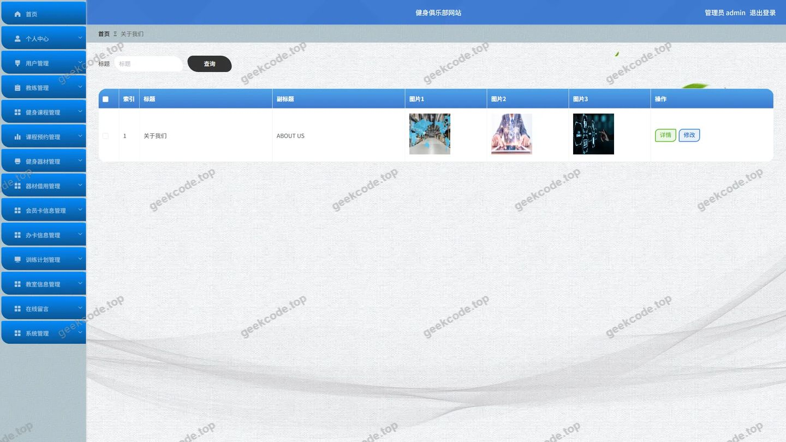</a>

<h4>前台-办卡信息列表</h4>

<h4>前台-会员卡信息列表</h4>

<h4>前台-健身课程列表</h4>

<a href="https://geekcode.top/archives/%E5%81%A5%E8%BA%AB%E4%BF%B1%E4%B9%90%E9%83%A8%E7%BD%91%E7%AB%99-%E8%AE%BA%E6%96%87?utm_source=github" title="查看完整源码">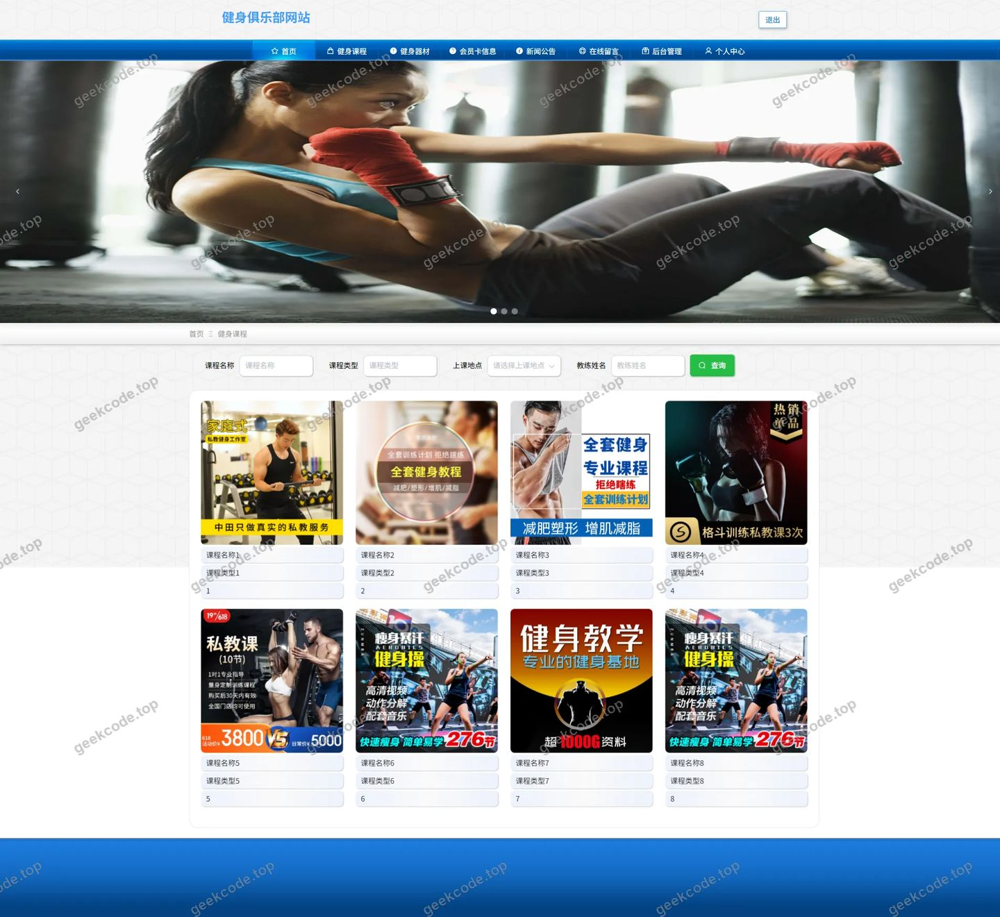</a>

<h4>前台-健身器材列表</h4>

<a href="https://geekcode.top/archives/%E5%81%A5%E8%BA%AB%E4%BF%B1%E4%B9%90%E9%83%A8%E7%BD%91%E7%AB%99-%E8%AE%BA%E6%96%87?utm_source=github" title="查看完整源码">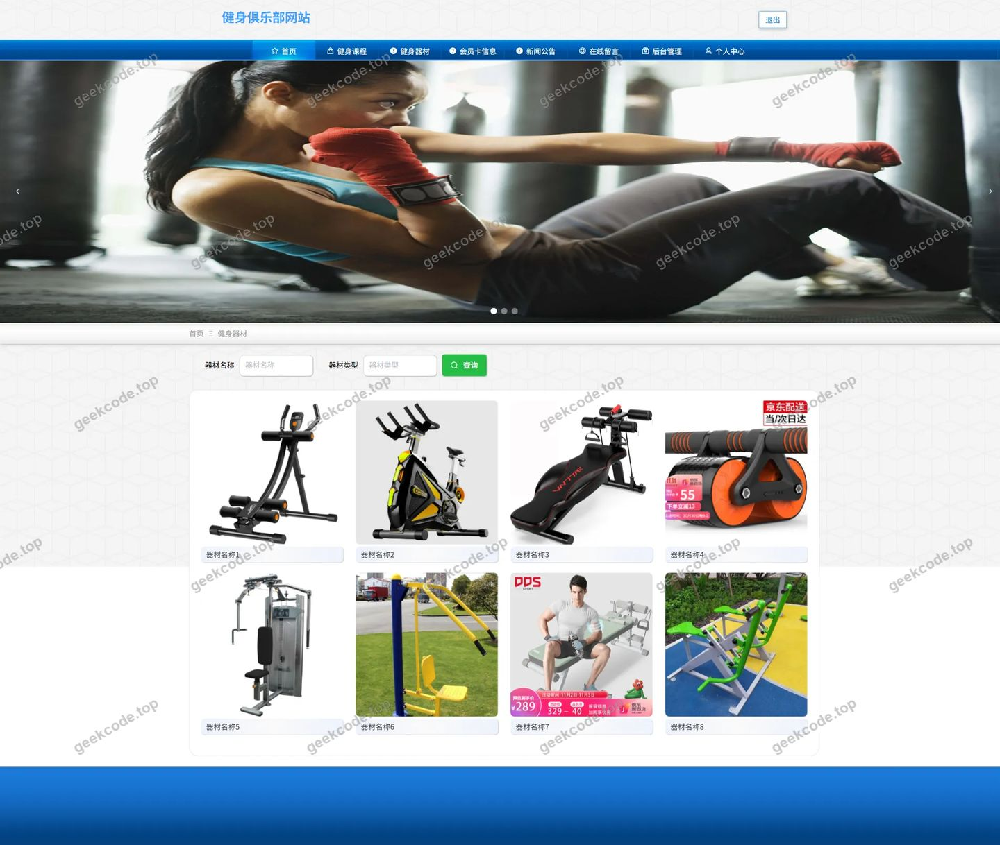</a>

<h4>前台-教练列表</h4>

<a href="https://geekcode.top/archives/%E5%81%A5%E8%BA%AB%E4%BF%B1%E4%B9%90%E9%83%A8%E7%BD%91%E7%AB%99-%E8%AE%BA%E6%96%87?utm_source=github" title="查看完整源码">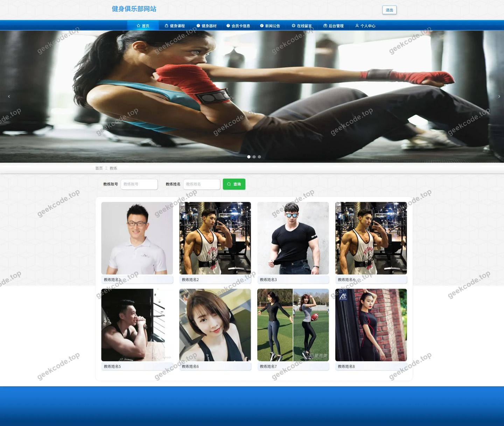</a>

<h4>前台-教室信息列表</h4>

<a href="https://geekcode.top/archives/%E5%81%A5%E8%BA%AB%E4%BF%B1%E4%B9%90%E9%83%A8%E7%BD%91%E7%AB%99-%E8%AE%BA%E6%96%87?utm_source=github" title="查看完整源码">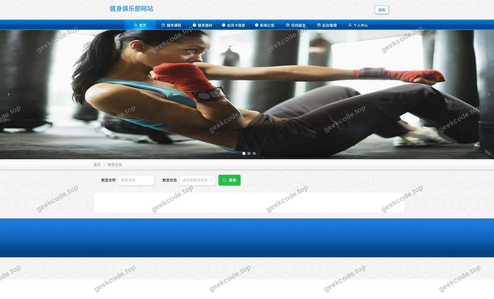</a>

<h4>前台-课程预约列表</h4>

<h4>前台-在线留言列表</h4>

<a href="https://geekcode.top/archives/%E5%81%A5%E8%BA%AB%E4%BF%B1%E4%B9%90%E9%83%A8%E7%BD%91%E7%AB%99-%E8%AE%BA%E6%96%87?utm_source=github" title="查看完整源码">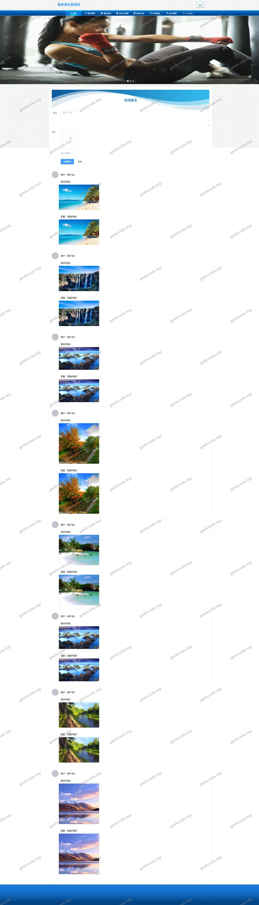</a>

<h4>前台-器材借用列表</h4>

<h4>前台-收藏列表</h4>

<a href="https://geekcode.top/archives/%E5%81%A5%E8%BA%AB%E4%BF%B1%E4%B9%90%E9%83%A8%E7%BD%91%E7%AB%99-%E8%AE%BA%E6%96%87?utm_source=github" title="查看完整源码">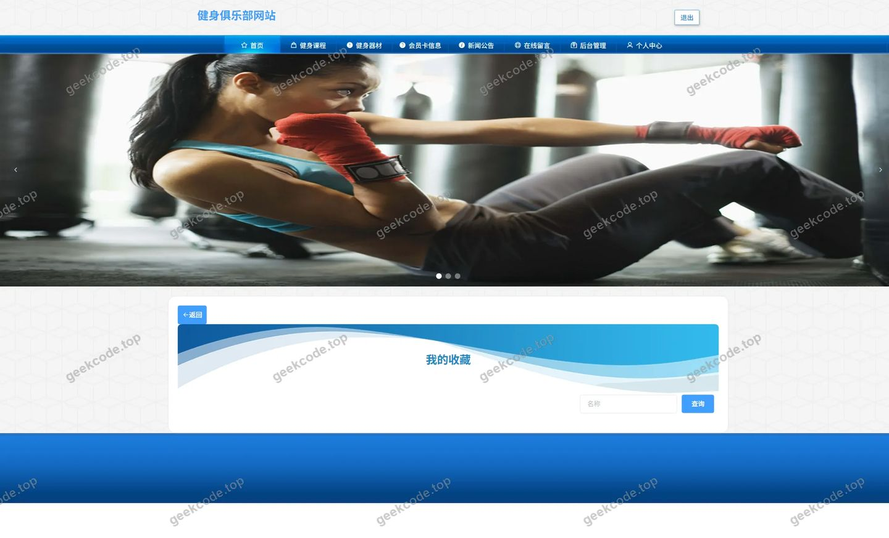</a>

<h4>前台-训练计划列表</h4>

<h4>前台-个人中心</h4>

<a href="https://geekcode.top/archives/%E5%81%A5%E8%BA%AB%E4%BF%B1%E4%B9%90%E9%83%A8%E7%BD%91%E7%AB%99-%E8%AE%BA%E6%96%87?utm_source=github" title="查看完整源码">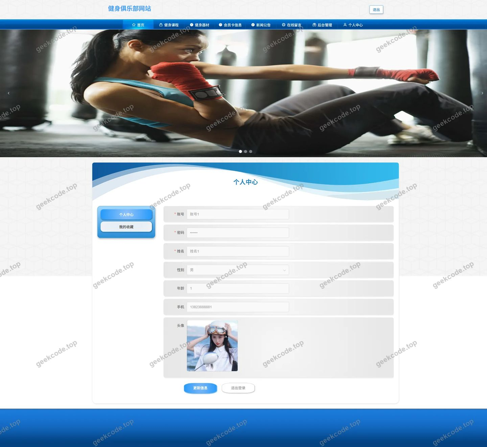</a>

<h4>前台-公告列表</h4>

<a href="https://geekcode.top/archives/%E5%81%A5%E8%BA%AB%E4%BF%B1%E4%B9%90%E9%83%A8%E7%BD%91%E7%AB%99-%E8%AE%BA%E6%96%87?utm_source=github" title="查看完整源码">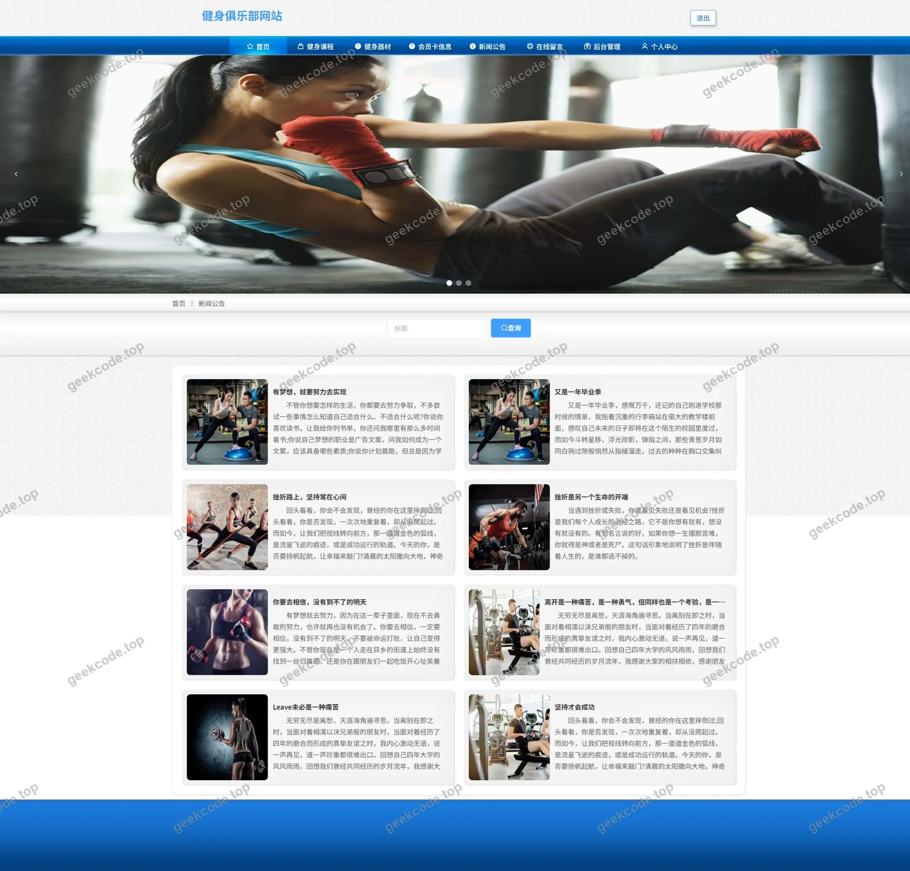</a>

<h3>后台管理端</h3>
<h4>后台-登录页</h4>

<h4>后台-关于我们</h4>

<h4>后台-健身课程</h4>

<a href="https://geekcode.top/archives/%E5%81%A5%E8%BA%AB%E4%BF%B1%E4%B9%90%E9%83%A8%E7%BD%91%E7%AB%99-%E8%AE%BA%E6%96%87?utm_source=github" title="查看完整源码">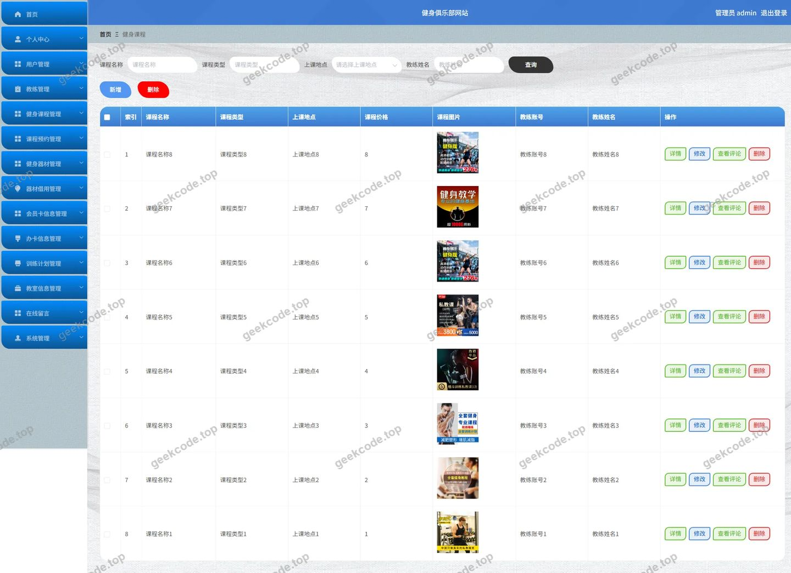</a>

<h4>后台-健身器材评论</h4>

<a href="https://geekcode.top/archives/%E5%81%A5%E8%BA%AB%E4%BF%B1%E4%B9%90%E9%83%A8%E7%BD%91%E7%AB%99-%E8%AE%BA%E6%96%87?utm_source=github" title="查看完整源码">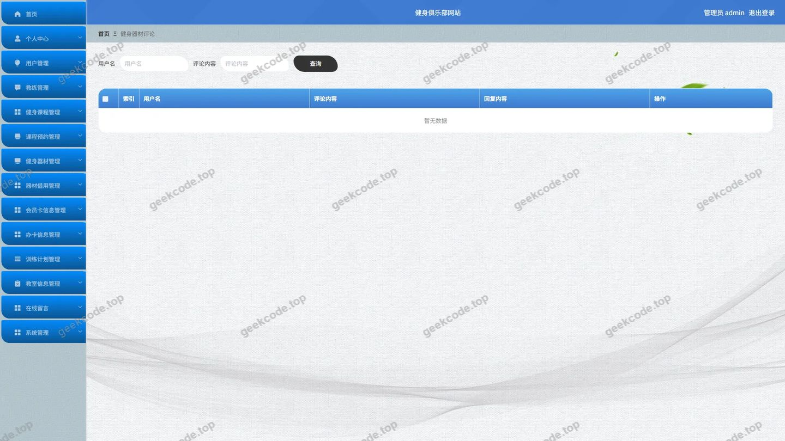</a>

<h4>后台-教练</h4>

<a href="https://geekcode.top/archives/%E5%81%A5%E8%BA%AB%E4%BF%B1%E4%B9%90%E9%83%A8%E7%BD%91%E7%AB%99-%E8%AE%BA%E6%96%87?utm_source=github" title="查看完整源码">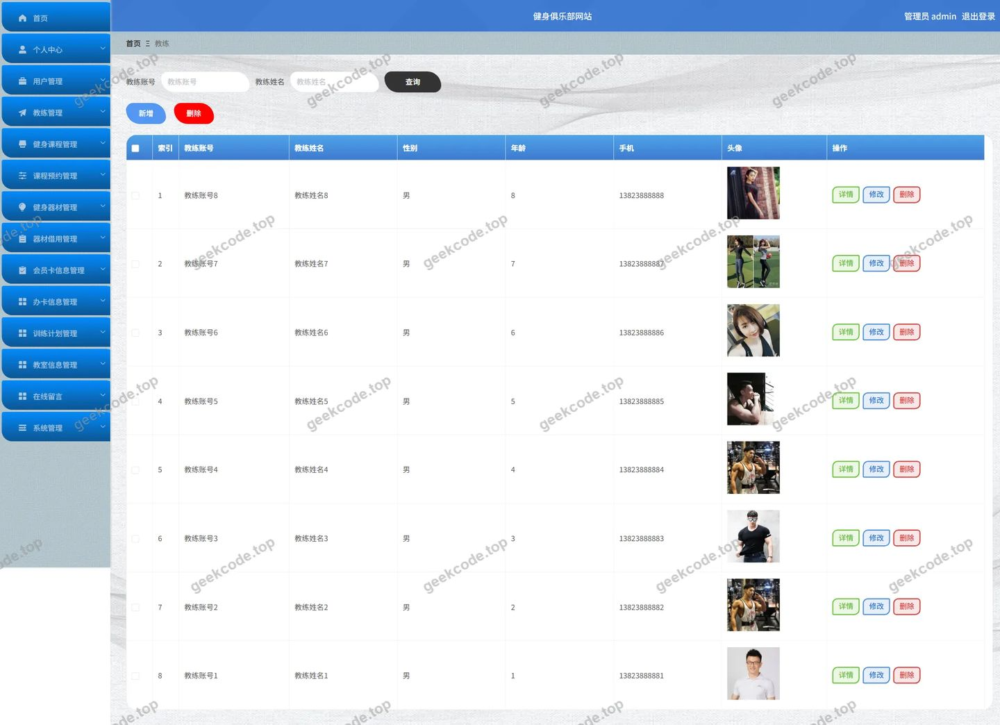</a>

<h4>后台-教室信息</h4>

<a href="https://geekcode.top/archives/%E5%81%A5%E8%BA%AB%E4%BF%B1%E4%B9%90%E9%83%A8%E7%BD%91%E7%AB%99-%E8%AE%BA%E6%96%87?utm_source=github" title="查看完整源码">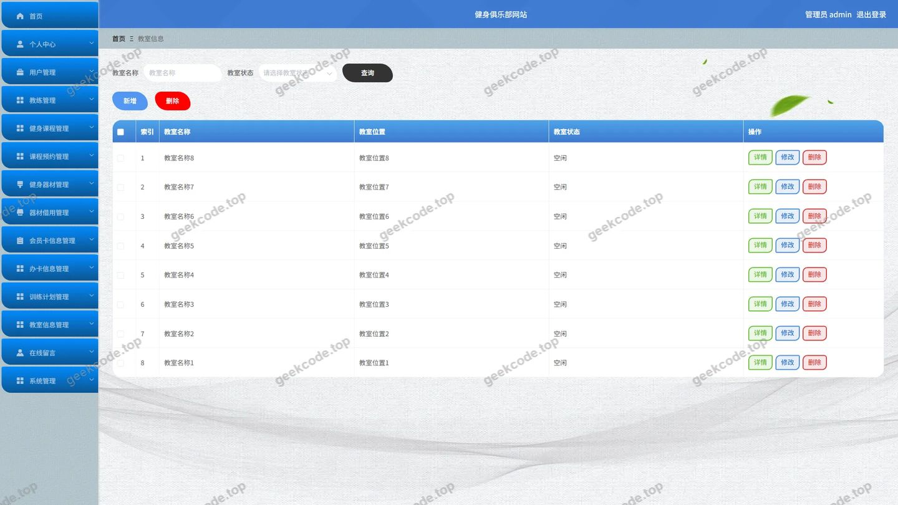</a>

<h4>后台首页</h4>

<a href="https://geekcode.top/archives/%E5%81%A5%E8%BA%AB%E4%BF%B1%E4%B9%90%E9%83%A8%E7%BD%91%E7%AB%99-%E8%AE%BA%E6%96%87?utm_source=github" title="查看完整源码">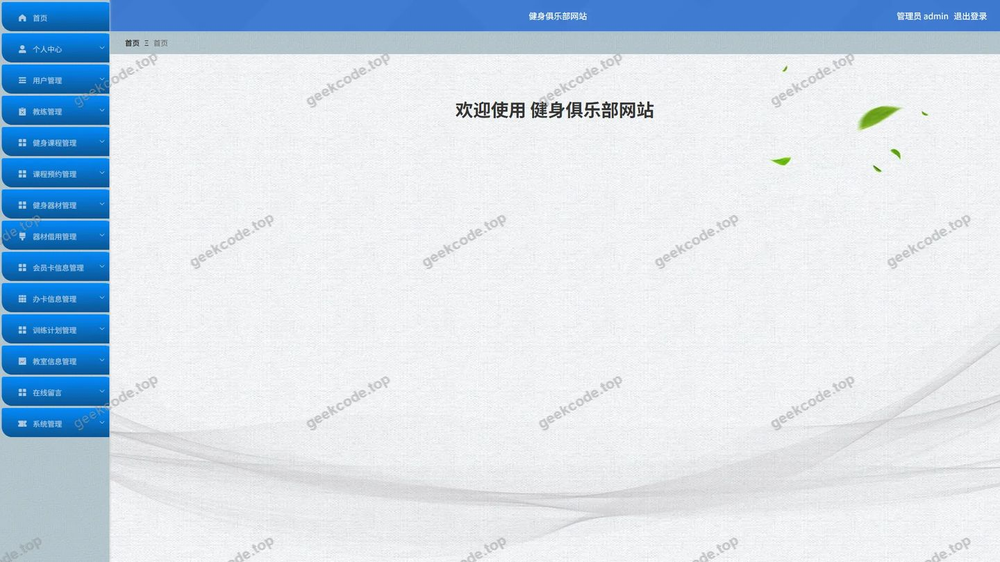</a>

<h4>后台-新闻公告</h4>

<a href="https://geekcode.top/archives/%E5%81%A5%E8%BA%AB%E4%BF%B1%E4%B9%90%E9%83%A8%E7%BD%91%E7%AB%99-%E8%AE%BA%E6%96%87?utm_source=github" title="查看完整源码">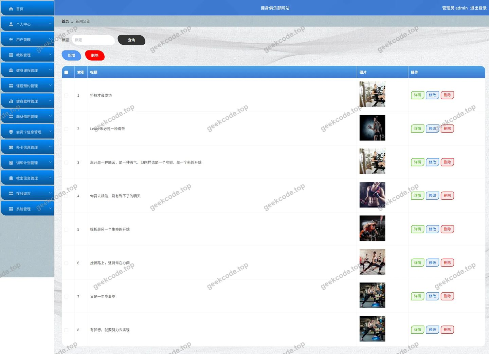</a>

---

## 获取完整源码

| 项目 | 说明 |
| --- | --- |
| 项目名 | 健身俱乐部网站--论文 |
| 运行截图 | 本文 22 张（站点带水印原图，仓库 `images/` 目录） |
| 完整源码 | [https://geekcode.top/archives/%E5%81%A5%E8%BA%AB%E4%BF%B1%E4%B9%90%E9%83%A8%E7%BD%91%E7%AB%99-%E8%AE%BA%E6%96%87?utm_source=github](https://geekcode.top/archives/%E5%81%A5%E8%BA%AB%E4%BF%B1%E4%B9%90%E9%83%A8%E7%BD%91%E7%AB%99-%E8%AE%BA%E6%96%87?utm_source=github) |
| 咨询微信 | **ir9372**（备注：jingpin-yuanma） |
| 更多项目 | [极客代码 geekcode.top](https://geekcode.top/?utm_source=github) |

> 需要源码、部署、改配置、跑不起来等问题，加微信 ir9372 沟通，说明项目名即可。
